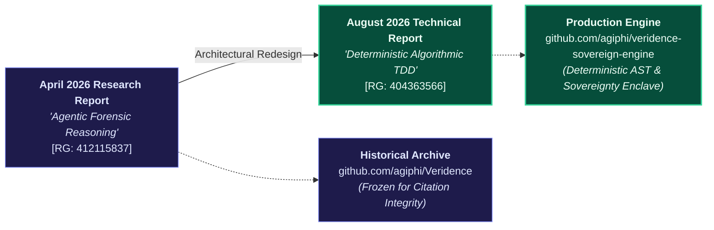
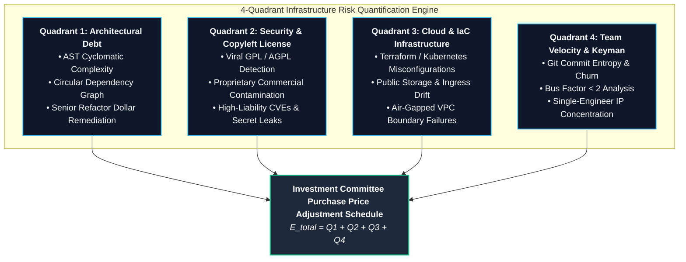
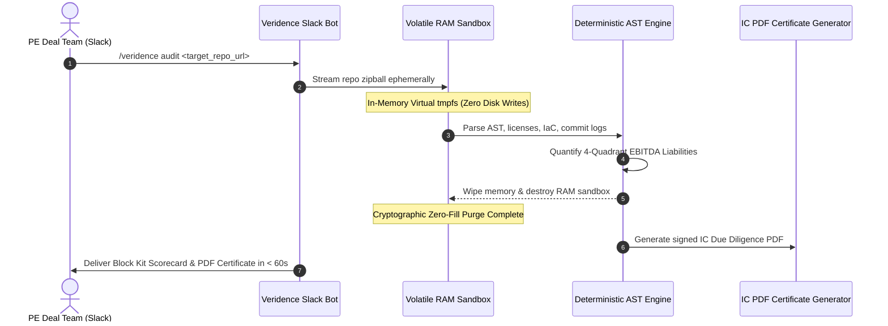

# Veridence: Deterministic Algorithmic Technical Due Diligence

[](https://www.researchgate.net/publication/404363566_Deterministic_Algorithmic_Technical_Due_Diligence_Air-Gapped_TDD_The_Sovereignty_Protocol_and_4-Quadrant_Infrastructure_Risk_F_Quantification)
[-blue)](https://www.veridence.agiphi.com)
[](https://www.veridence.agiphi.com/slack)
[](https://www.veridence.agiphi.com/?view=dashboard)
[](#licensing--commercial-terms)

> **Official Technical Specification & Sovereign Due Diligence Architecture**  
> Aligned with the peer-reviewed technical report:  
> **"Deterministic Algorithmic Technical Due Diligence: Air-Gapped TDD, The Sovereignty Protocol, and 4-Quadrant Infrastructure Risk Quantification"**  
> *Author:* Precious O. Agi, Agiphi Inc. (August 2026)  
> *Academic Publication:* [ResearchGate Preprint 404363566](https://www.researchgate.net/publication/404363566_Deterministic_Algorithmic_Technical_Due_Diligence_Air-Gapped_TDD_The_Sovereignty_Protocol_and_4-Quadrant_Infrastructure_Risk_F_Quantification)  
> *Case Study:* [Production Case Study](https://preciousagi.agiphi.com/case-studies/technical-due-diligence)

---

## 🏛️ Academic & Historical Provenance: What It Was vs. What It Is Now

Veridence evolved across two foundational research phases. To preserve academic citation continuity, our historical exploratory implementation is maintained as an immutable historical archive.



### The Architectural Evolution

| Dimension | Historical Research Archive (April 2026) | Current Sovereign Production Architecture (August 2026) |
| :--- | :--- | :--- |
| **Foundational Publication** | *"Agentic Forensic Reasoning for Technical Due Diligence"* ([ResearchGate 412115837](https://www.researchgate.net/publication/412115837_Agentic_Forensic_Reasoning_for_Technical_Due_Diligence_The_Sovereignty_Protocol_and_Infrastructure_Risk_F_Quantification)) | *"Deterministic Algorithmic Technical Due Diligence: Air-Gapped TDD, The Sovereignty Protocol, and 4-Quadrant Infrastructure Risk Quantification"* ([ResearchGate 404363566](https://www.researchgate.net/publication/404363566_Deterministic_Algorithmic_Technical_Due_Diligence_Air-Gapped_TDD_The_Sovereignty_Protocol_and_4-Quadrant_Infrastructure_Risk_F_Quantification)) |
| **Analysis Engine** | Agentic LLM reasoning chains & multi-turn heuristic prompting | **100% Deterministic Static Analysis** (Tree-sitter AST parsing, compiler symbol resolution, rule-based heuristics) |
| **Reliability** | Non-zero stochastic variance (model hallucinations, prompt drift) | **Zero Hallucination Guarantee** (Identical commit trees produce mathematically identical EBITDA findings) |
| **Data Sovereignty** | API token pass-through to third-party generative inference endpoints | **The Sovereignty Protocol**: 100% ephemeral RAM sandboxing, zero disk writes, zero model retraining, instant memory wipe |
| **Risk Framework** | Qualitative narrative reports | **4-Quadrant Infrastructure Risk Quantification** ($Q_1$ Architecture, $Q_2$ Security & GPL, $Q_3$ Cloud IaC, $Q_4$ Team Keyman) |
| **Primary Interface** | Prototype web dashboard | **Slack Deal-Room Bot (`/veridence`)**, Web Console Cockpit, and Model Context Protocol (MCP) server |
| **Repository Status** | [Historical Archive (`agiphi/Veridence`)](https://github.com/agiphi/Veridence) *(Frozen)* | [Sovereign Engine (`agiphi/veridence-sovereign-engine`)](https://github.com/agiphi/veridence-sovereign-engine) *(Active Production)* |

---

## 🔬 The 4-Quadrant Infrastructure Risk Quantification Model

Veridence converts subjective engineering surveys into **deterministic balance sheet purchase price adjustments** engineered for Private Equity sponsors, Corporate M&A acquirers, and General Counsel.



### Mathematical Formulation

Total recommended EBITDA liability adjustment ($E_{\text{total}}$) is computed as the sum of liabilities quantified across four orthogonal quadrants:

$$
E_{\text{total}} = Q_1(\text{Architecture}) + Q_2(\text{Security \& License}) + Q_3(\text{Cloud \& IaC}) + Q_4(\text{Team \& Velocity})
$$

Where:

1. **$Q_1$: Architectural Debt Remediation Cost**
   Tree-sitter Abstract Syntax Trees (ASTs) calculate complexity exceedance over maintainable thresholds ($M_{\text{threshold}} = 15$):

   $$
   Q_1 = \sum_{f \in \text{Functions}} \max(0, C(f) - M_{\text{threshold}}) \times H_{\text{refactor}} \times R_{\text{senior}}
   $$

   *(where $H_{\text{refactor}}$ is benchmark hours per complexity unit, and $R_{\text{senior}} = \$175/\text{hr}$ is benchmark engineering labor).*

2. **$Q_2$: Copyleft & Security Legal Liability**
   Evaluates direct and transitive dependency trees against the SPDX license index. Viral licenses (GPL-2.0, GPL-3.0, AGPL-3.0) integrated into proprietary commercial software impose a deterministic re-engineering liability ($L_{\text{rewrite}}$) or statutory exposure penalty.

3. **$Q_3$: Cloud & IaC Governance Debt**
   Scans Terraform, CloudFormation, and Helm charts for unencrypted storage, missing IAM boundaries, and multi-cloud architectural fragmentation.

4. **$Q_4$: Team Entropy & Keyman Risk**
   Computes the **Shannon Entropy** of author commits across the target repository:

   $$
   H(C) = -\sum_{i=1}^n p(a_i) \log_2 p(a_i)
   $$

   When author distribution reveals a **Bus Factor $< 2$** (one engineer authored $>70\%$ of core IP), an executive retention escrow reserve is allocated.

---

## 🛡️ The Sovereignty Protocol (Air-Gapped RAM Sandbox)

In high-stakes corporate acquisitions, target source code represents critical proprietary IP. Veridence guarantees zero-retention code privacy through an ephemeral RAM enclave architecture:



* **Ephemeral In-Memory Processing:** Codebases are streamed into volatile virtual memory (`tmpfs`). Nothing is written to physical disk.
* **Zero Model Training:** 100% deterministic local AST parsing and regex rules. Code is never transmitted to OpenAI, Anthropic, or external model providers.
* **Instant Cryptographic Destruction:** Volatile RAM buffers are overwritten with zeros and destroyed within milliseconds of report dispatch.

---

## 🔌 Private Repository & Multi-Platform Ingestion Guide

Veridence supports flexible repository ingestion across all major VCS providers and virtual data rooms.

### Option A: The 1-Click GitHub App (Recommended — Zero Tokens)
* **Audience:** Non-technical deal leads, investment associates, and target engineering leads.
* **How it works:**
  1. The target repository admin clicks **[Install GitHub App](https://github.com/apps/veridence)**.
  2. Select organization and pick "All repositories" or "Select repositories".
  3. Click **Install & Authorize**.
  4. In Slack, run: `/veridence audit https://github.com/target-org/private-repo`.  
     *Cryptographic installation tokens authenticate automatically. Zero token management required.*

### Option B: 1-Time Workspace Personal Access Token (PAT) Link
If your team does not have organization admin rights to install GitHub Apps, configure a 1-time PAT:
1. In GitHub, go to **Settings** ➔ **Developer settings** ➔ **Personal access tokens (classic)** ➔ **Generate new token**.
2. Select scopes: Check only **`repo`** (Full control of private repositories).
3. Copy the generated token (`ghp_...`).
4. In Slack, run this command **once per workspace**:
   ```bash
   /veridence auth ghp_YourPersonalAccessTokenHere
   ```
5. Every deal team member in that channel can now audit private repositories seamlessly without ever needing a token again.

### Option C: Virtual Data Rooms (VDR) & Cloud Storage Escrow Links
In traditional M&A diligence, sellers share sanitized ZIP archives through secure data room links:
```bash
# Google Drive Shared Link
/veridence audit https://drive.google.com/file/d/1A2B3C4D5E.../view

# Box.com Enterprise Link
/veridence audit https://app.box.com/s/abcdef123456...

# Pre-signed AWS S3 / Cloudflare R2 Archive Link
/veridence audit https://s3.amazonaws.com/dealroom-escrow/snapshot.zip?X-Amz-Signature=...
```

### Option D: Air-Gapped Web Console Drag-and-Drop
For offline or highly classified targets, open the **[Veridence Web Console](https://www.veridence.agiphi.com/?view=dashboard)** and drag any target `.zip` file directly into the browser. The report generates locally without external cloud connectivity.

---

## 🤖 Slack Deal-Room Bot Commands

| Command | Operational Purpose |
| :--- | :--- |
| `/veridence help` | Displays interactive slash command directory, operational guidelines, and diligence syntax. |
| `/veridence audit <url> [token]` | Executes an ephemeral RAM audit on target repository and renders an executive Block Kit scorecard. |
| `/veridence watch <url>` | *(Commercial Tiers)* Subscribes channel to 24/7 continuous commit surveillance; alerts deal rooms to newly introduced EBITDA liabilities. |
| `/veridence repos` | Lists all active target repositories currently monitored within this Slack workspace. |
| `/veridence auth <token>` | Registers a workspace-wide GitHub PAT for seamless private repository scanning. |
| `/veridence register <key>` | Binds an institutional license key to the workspace for enterprise quotas and custom SLAs. |

---

## 📄 Investment Committee Due Diligence Certificate

Every audit automatically generates an audit-grade, cryptographically signed PDF certificate:
* **EBITDA Purchase Price Adjustment Schedule**
* **100-Day Post-Merger Remediation Roadmap** (Phase 1: Days 1–30 Stop the Bleed; Phase 2: Days 31–60 Structural; Phase 3: Days 61–100 Optimization)
* **SPDX License & GPL Infection Audit**
* **SOC-2 & Air-Gapped Sovereign EPC Attestation**

---

## ⚖️ Licensing & Commercial Terms

* **Academic Citation:** Citations must reference the [August 2026 Technical Report](https://www.researchgate.net/publication/404363566_Deterministic_Algorithmic_Technical_Due_Diligence_Air-Gapped_TDD_The_Sovereignty_Protocol_and_4-Quadrant_Infrastructure_Risk_F_Quantification).
* **Commercial Inquiries:** Enterprise subscriptions, custom diligence SLAs, and Sovereign VPC Escrow are invoiced via Net 15/30 Domestic Wire or GCP Marketplace Private Offer.
* **Licensing Desk:** [contact@agiphi.com](mailto:contact@agiphi.com) | [Veridence Gateway](https://www.veridence.agiphi.com/gateway)

---

### Citation

```bibtex
@techreport{agi2026deterministic,
  title={Deterministic Algorithmic Technical Due Diligence: Air-Gapped TDD, The Sovereignty Protocol, and 4-Quadrant Infrastructure Risk Quantification},
  author={Agi, Precious O.},
  institution={Agiphi Inc.},
  year={2026},
  month={August},
  doi={10.13140/RG.2.2.17983.52648},
  url={https://www.researchgate.net/publication/404363566}
}
```
