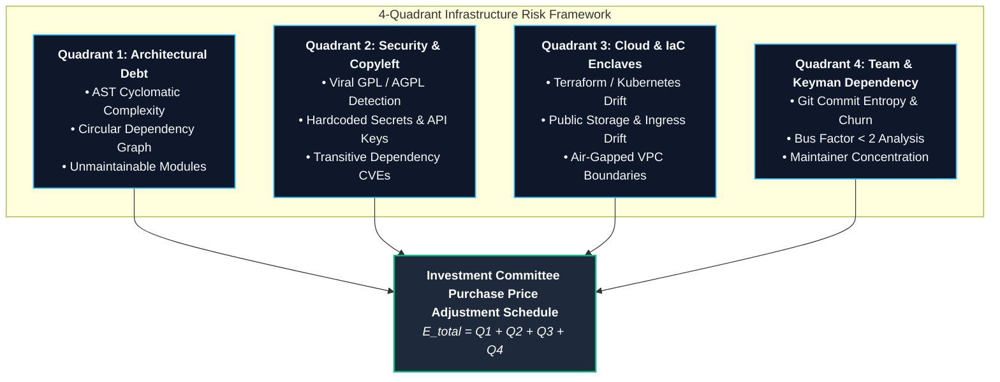

# The 4-Quadrant Infrastructure Risk Quantification Framework

Veridence models codebase risk not as abstract "code quality scores" or subjective developer feedback, but as **deterministic, balance sheet purchase price adjustments ($E_{\text{total}}$)**. 

During mergers and acquisitions (M&A), unaddressed architectural debt, security vulnerabilities, and licensing infractions translate directly into post-acquisition capital expenditure.

---

## Mathematical Formulation

$$
E_{\text{total}} = Q_1(\text{Architecture}) + Q_2(\text{Security \& License}) + Q_3(\text{Cloud \& IaC}) + Q_4(\text{Team \& Velocity})
$$

---

### Quadrant 1: Architectural & Codebase Debt ($Q_1$)

Target codebases often accumulate unrefactored legacy debt that reduces post-merger development velocity and requires significant engineering reinvestment.

* **AST Cyclomatic Complexity:** Functions with McCabe cyclomatic complexity exceedances over maintainability thresholds ($M_{\text{threshold}} = 15$) are identified deterministically:
  $$
  Q_1 = \sum_{f \in \text{Functions}} \max(0, C(f) - M_{\text{threshold}}) \times H_{\text{refactor}} \times R_{\text{senior}}
  $$
  *(where $H_{\text{refactor}}$ represents standard refactoring hours per complexity unit, and $R_{\text{senior}} = \$175/\text{hr}$ represents benchmark engineering labor).*
* **Circular Dependency Ring Analysis:** Dependency graphs are parsed to identify circular import chains that prohibit modular extraction or microservice refactoring.
* **Dead Code Identification:** AST symbol graphs detect unreferenced classes, orphan controllers, and abandoned legacy routes that inflate maintenance overhead.

---

### Quadrant 2: Security & Copyleft Licensing Liability ($Q_2$)

Software license breaches represent statutory and commercial liabilities that can force acquirers to open-source proprietary IP or defend against copyright lawsuits.

* **SPDX License Dependency Mapping:** Ingests `package.json`, `requirements.txt`, `go.mod`, `pom.xml`, and `Cargo.lock` to catalog every third-party component.
* **Viral Copyleft Infection (GPL/AGPL):** Evaluates licensing terms against proprietary commercial use. If viral licenses (GPL-2.0, GPL-3.0, AGPL-3.0) are statically linked into proprietary core assets, Veridence quantifies:
  $$
  L_{\text{copyleft}} = \text{Cost to Clean-Room Re-Engineer Infiltrated Modules}
  $$
* **High-Liability CVEs:** Flags known vulnerabilities in production dependencies with high CVSS scores and active exploits.
* **Hardcoded Secret Detection:** High-entropy regex scanning detects private keys, cloud tokens, database connection URIs, and authentication secrets committed to version history.

---

### Quadrant 3: Cloud & Infrastructure Governance ($Q_3$)

Infrastructure-as-Code (IaC) configuration manifests determine whether target cloud deployments are resilient, sovereign, and cost-effective.

* **IaC Static Analysis:** Evaluates Terraform (`.tf`), Kubernetes manifests (`.yaml`), Dockerfiles, and CloudFormation templates.
* **Public Egress & S3 Bucket Exposure:** Identifies misconfigured cloud storage resources lacking server-side encryption or exposing public read/write access.
* **Sovereign VPC Peering:** Detects unencrypted cross-region traffic, missing egress gateways, and violation of air-gapped data sovereignty mandates.

---

### Quadrant 4: Team Velocity & Keyman Dependency ($Q_4$)

Engineering team dynamics directly impact post-acquisition execution capability.

* **Shannon Commit Entropy:** Computes the informational entropy of author commits:
  $$
  H(C) = -\sum_{i=1}^n p(a_i) \log_2 p(a_i)
  $$
* **Bus Factor Determination:** Calculates the minimum number of engineers whose departure would paralyze ongoing system maintenance.
* **Keyman Escrow Allocation:** If an individual engineer contributed $>70\%$ of core IP over the trailing 12 months, Veridence recommends an executive retention escrow holdback to prevent intellectual property abandonment.
