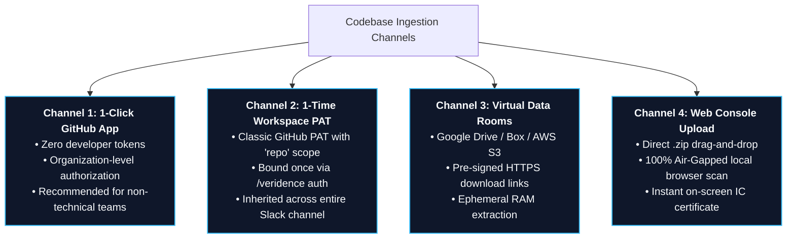

# Private Repository & Multi-Platform Ingestion Guide

In M&A and Private Equity transactions, target codebases are virtually always private, confidential, or stored within virtual data rooms. Veridence provides four flexible ingestion pathways tailored to deal teams and corporate counsel.

---



---

## Option A: The 1-Click GitHub App (Recommended — Zero Token Management)

The simplest pathway for deal teams and target companies. No developer settings or API keys are handled.

1. **Authorize the App:**
   The target company's engineering lead or repository administrator visits:  
   ➔ **[Install Veridence GitHub App](https://github.com/apps/veridence)**
2. **Select Scope:**
   GitHub displays an authorization modal. The admin selects their organization and specifies **"Only select repositories"** (e.g., `acquirer-target-core`).
3. **Execute in Slack:**
   Inside your deal-room Slack channel, run:
   ```bash
   /veridence audit https://github.com/target-org/acquirer-target-core
   ```
   *The Veridence bot uses GitHub App cryptographic installation tokens behind the scenes. Zero token management.*

---

## Option B: 1-Time Workspace Personal Access Token (PAT) Link

If organization administration restrictions prevent installing the GitHub App, an authorized team member can link a classic Personal Access Token once:

1. **Generate Token:**
   * Log into GitHub (`github.com`).
   * Click profile icon (top-right) ➔ **Settings** ➔ scroll down to **Developer settings** (bottom-left).
   * Click **Personal access tokens** ➔ **Tokens (classic)** ➔ **Generate new token (classic)**.
   * Note: `Veridence Deal Room`.
   * Expiration: `30 days` (or length of diligence period).
   * Scopes: Check **`repo`** (Full control of private repositories).
   * Click green **Generate token** button and copy the token (`ghp_...`).
2. **Register Once in Slack:**
   In your deal-room Slack channel, execute:
   ```bash
   /veridence auth ghp_YourCopiedTokenStringHere
   ```
3. **Audit Privately:**
   Every member of the Slack channel can now audit private repositories without specifying tokens:
   ```bash
   /veridence audit https://github.com/target-org/private-repo
   ```

---

## Option C: Virtual Data Rooms & Cloud Storage Links

In institutional transactions, target companies often export sanitized codebase archives into Virtual Data Rooms (VDRs) or shared cloud folders:

* **Google Drive:**
  ```bash
  /veridence audit https://drive.google.com/file/d/1A2B3C4D5E.../view
  ```
* **Box.com:**
  ```bash
  /veridence audit https://app.box.com/s/abcdef123456...
  ```
* **Pre-signed AWS S3 / Cloudflare R2:**
  ```bash
  /veridence audit https://s3.amazonaws.com/target-vdr-escrow/snapshot.zip?X-Amz-Signature=...
  ```

---

## Option D: Air-Gapped Web Console Drag-and-Drop

For offline codebases or highly classified acquisitions:

1. Navigate to the **[Veridence Web Console](https://www.veridence.agiphi.com/?view=dashboard)**.
2. Drag and drop any `.zip` archive directly into the browser upload portal.
3. The deterministic scan executes immediately on-screen without requiring any Git credentials or external cloud connectivity.
